**Software Development @ Evolui Tecnologia**

Java · Spring Boot · Angular · TypeScript · AI Agents

## 👋 About me

I work on software for the **public sector**, developing and maintaining applications across Java backends, Angular interfaces, databases, and integrations. My day-to-day work includes features, business rules, troubleshooting, and the ongoing evolution of existing systems.

**AI is part of how I develop software**, from understanding a codebase and planning changes to implementation and code review. Working this way involves both understanding the application and preparing the context and tools that agents need to work within it.

Alongside product development, I contribute to **agent skills, development harnesses, and workflow automation**. I also share practices and tooling with the team, particularly around using agents in legacy applications with established architectures and conventions.

## 🤖 AI in my development workflow

I work with agents as part of the engineering process, adapting their instructions and tools to the project rather than relying on a generic setup.

- **Context engineering:** organizing architecture notes, project conventions, module-specific guidance, and relevant sources of information.
- **Skills and harnesses:** creating and maintaining reusable skills, prompts, rules, `AGENTS.md`, and `IA_CONTEXT.md` files.
- **MCP integrations:** connecting agents to development tools, IDEs, databases, and project information.
- **Codebase exploration:** using indexed source code, vector search, and dependency graphs to retrieve relevant context.
- **Planning and implementation:** breaking down tasks, discussing architectural choices with models, and checking changes against the application's behavior.

My work with these tools is supported by knowledge of **tokenization, token usage, context windows, content ingestion, and RAG**. I’m interested in how these concepts affect the context available to an agent and the way a development task is approached.

## ⚙️ Product development

Most of my product work is in systems for **municipal administration**, including HR, payroll, taxation, and public service portals.

| Area | What I work on |
|:---|:---|
| **Backend** | Java services, REST APIs, DTOs, validation, and business rules |
| **Frontend** | Angular components, forms, searches, pagination, and portal workflows |
| **Data and integrations** | SQL queries, web services, shared libraries, and communication between applications |
| **Reporting** | Operational reports, filters, and data retrieval with JasperReports |
| **Testing and maintenance** | Automated tests, issue investigation, bug fixes, and changes to existing functionality |

Working across these areas means following a change through its different layers: the interface, the API, the business logic, and the data it depends on.

## 🔀 Git, GitHub, and delivery workflows

I work with branching strategies and the promotion of changes between development, QA, and production. This includes understanding the history and dependencies of a change, especially when releases involve several active branches.

- Working with **pull requests, cherry-picks, and conflict resolution**.
- Maintaining skills that help agents follow the project's Git workflow and analyze conflicts.
- Maintaining **GitHub Actions** workflows, including triggers, conditions, variables, and dependency references.
- Adjusting **AI-based code review and correction workflows**, including prompts and agent execution.
- Discussing improvements to integration and release processes with the team.

## 🧰 Technologies and tools

  

 

| Area | Technologies and practices |
|:---|:---|
| **Backend** | Java · Spring Boot · REST APIs · Maven |
| **Frontend** | Angular · TypeScript · HTML · SCSS |
| **Data and reporting** | SQL · relational databases · JasperReports · Liquibase |
| **Testing** | JUnit · Mockito · business rule validation |
| **Agents and context** | MCP · skills · harnesses · prompts · context engineering |
| **Knowledge retrieval** | RAG concepts · vector search · dependency graphs |
| **Development and delivery** | IntelliJ IDEA · Git · GitHub · GitHub Actions |

## 💬 Topics I enjoy working with

AI in software development · coding agents · context engineering · MCP · Git workflows · Java · Angular · legacy systems

[Personal GitHub → pereira-matheus](https://github.com/pereira-matheus)

## 💣 Contribution graph

<a href="https://github.com/abozanona/pacman-contribution-graph">
  <picture>
    <source media="(prefers-color-scheme: dark)" srcset="./assets/bomberman-contribution-graph-dark.svg"/>
    <source media="(prefers-color-scheme: light)" srcset="./assets/bomberman-contribution-graph.svg"/>
    
  </picture>
</a>

